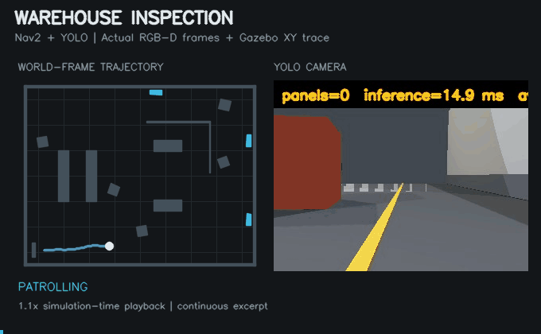

# ROS 2 Warehouse Inspection Robot

A mobile robot that patrols a Gazebo warehouse, spots inspection panels with
YOLO, drives closer and records each visit before continuing its route.
Built with ROS 2 Jazzy and Nav2.



The demo shows one panel approach and the return to patrol. Left: recorded robot
position. Right: the camera feed with YOLO detections. A continuous 25-second
clip at 1.1× simulation speed.

## Features

- Differential-drive robot with lidar and an RGB-D camera
- Saved warehouse map, AMCL localisation and Nav2 navigation
- YOLO training images generated from Gazebo, with automatic labels
- GPU detection and depth-based panel localisation
- Patrol, panel approach, visit logging and route recovery
- One launch command for the simulation, navigation and detector

```text
Patrol -> Detect panel -> Confirm target -> Pause patrol
       -> Approach panel -> Record result -> Resume patrol
```

## Packages

- `diff_drive_description`: robot model, sensors, Gazebo worlds, maps and Nav2 configuration.
- `robot_perception`: synthetic dataset collection and RGB-D YOLO detection.
- `autonomy_missions`: patrol, approach and inspection mission logic.

## Requirements

- Ubuntu 24.04
- ROS 2 Jazzy Desktop
- Gazebo Harmonic / `ros_gz`
- Nav2 and SLAM Toolbox
- Python 3.12
- NVIDIA GPU with a compatible PyTorch installation

## Setup

```bash
source /opt/ros/jazzy/setup.bash
cd ~/warehouse-inspection-robot

rosdep install --from-paths src --ignore-src -r -y

python3 -m venv .venv-yolo
.venv-yolo/bin/python -m pip install \
  torch==2.11.0 torchvision==0.26.0 \
  --index-url https://download.pytorch.org/whl/cu128
.venv-yolo/bin/python -m pip install \
  numpy==1.26.4 opencv-python==4.11.0.86 ultralytics==8.4.129

colcon build --symlink-install
source install/setup.bash
```

## Run

```bash
ros2 launch robot_perception inspection_patrol.launch.py
```

Gazebo, RViz and the annotated camera view will open. Mission results are
written to `~/.ros/autonomy_lab/inspection_records`.

To run with the windows closed:

```bash
ros2 launch robot_perception inspection_patrol.launch.py \
  headless:=true use_rviz:=false show_debug_image:=false
```

## Test results

The latest test used 20 fresh simulation launches in the same warehouse,
using ROS 2 Jazzy in WSL2, with up to two simulations running at once.

| Measure | Result |
|---|---:|
| Complete missions | 19/20 (95%) |
| Complete patrol routes | 19/20 (95%) |
| Recorded panel approaches | 62/62 |

A complete mission reaches all 13 waypoints, completes at least one panel
approach and finishes with every approach successful. Every failed launch
counts in the totals above.

Nineteen missions passed with no skipped waypoints or manual intervention.
One launch timed out during startup while waiting for the robot description
and Nav2 services. It counts as a failed mission.
Velocity commands use a separate ROS–Gazebo bridge, started after robot spawning.
These results cover one fixed warehouse scene; varied scenes still need testing.

[Full test conditions and individual results](docs/validation-2026-10-13/README.md).

## Current scope

The detector recognises one class, `inspection_panel`, and was trained on
synthetic images from this warehouse. Navigation uses Gazebo ground-truth
odometry together with AMCL.

The robot records whether it reached each selected approach goal. It can count
the same physical panel more than once when position estimates drift. Defect
detection, unique-panel coverage and real-world testing remain future work.

## License

GNU Affero General Public License v3.0. See [LICENSE](LICENSE).
