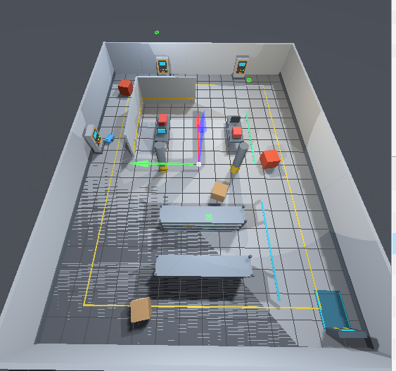
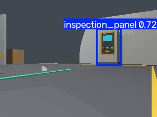

# ROS 2 Warehouse Inspection Robot

A ROS 2 Jazzy simulation of an autonomous warehouse inspection robot. The
robot navigates a Gazebo warehouse with Nav2, patrols a fixed route, detects
inspection panels with a custom YOLO model, approaches confirmed targets,
records the result, and resumes its patrol.

| Gazebo warehouse | YOLO panel detection |
| --- | --- |
|  |  |

## Features

- Differential-drive robot with lidar and an RGB-D camera
- Warehouse simulation, saved map, AMCL localization and Nav2 navigation
- Automatic synthetic YOLO dataset generation using Gazebo segmentation labels
- GPU YOLO inference with RGB-D target localization in the map frame
- Patrol interruption, target approach, inspection logging and patrol recovery
- One launch file for the complete simulation

```text
Patrol -> Detect panel -> Confirm target -> Pause patrol
       -> Approach panel -> Record result -> Resume patrol
```

The repository contains three ROS 2 packages:

- `diff_drive_description`: robot model, sensors, Gazebo worlds, maps and Nav2 configuration.
- `robot_perception`: synthetic dataset collection and RGB-D YOLO detection.
- `autonomy_missions`: patrol, approach and inspection mission logic.

## Requirements

- Ubuntu 24.04
- ROS 2 Jazzy Desktop
- Gazebo Harmonic / `ros_gz`
- Nav2 and SLAM Toolbox
- Python 3.12
- NVIDIA GPU with a compatible PyTorch installation

## Setup

```bash
source /opt/ros/jazzy/setup.bash
cd ~/warehouse-inspection-robot

rosdep install --from-paths src --ignore-src -r -y

python3 -m venv .venv-yolo
.venv-yolo/bin/python -m pip install \
  torch==2.11.0 torchvision==0.26.0 \
  --index-url https://download.pytorch.org/whl/cu128
.venv-yolo/bin/python -m pip install \
  numpy==1.26.4 opencv-python==4.11.0.86 ultralytics==8.4.129

colcon build --symlink-install
source install/setup.bash
```

## Run

```bash
ros2 launch robot_perception inspection_patrol.launch.py
```

Gazebo, RViz and the annotated camera view will open. Mission results are
written to `~/.ros/autonomy_lab/inspection_records`.

The included detector was trained only on synthetic images from this warehouse
and recognizes one class: `inspection_panel`. This is a simulation project, not
a real-world safety or inspection system.

## License

GNU Affero General Public License v3.0. See [LICENSE](LICENSE).
